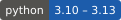
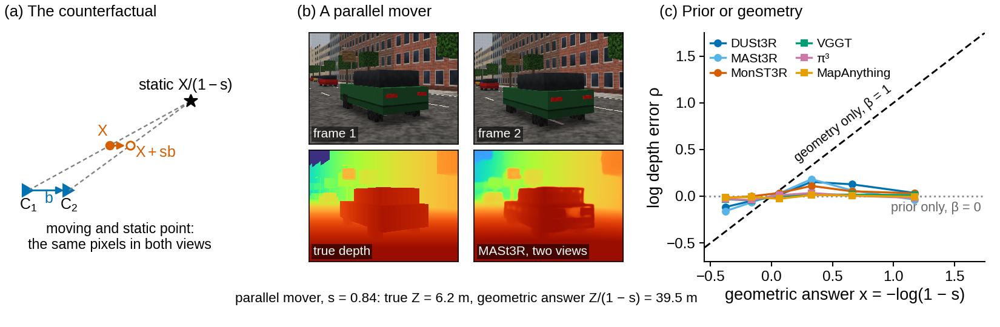
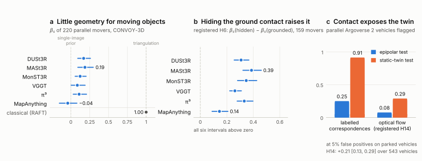
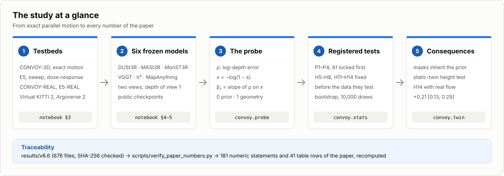
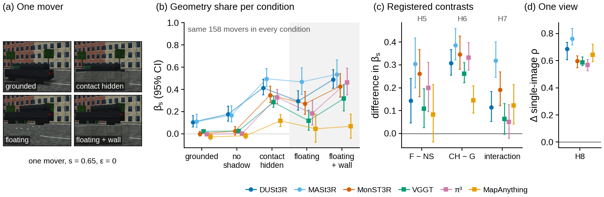
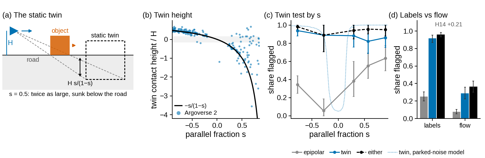

<div align="center">

# Parallel Motion as an Exact Counterfactual

### How Much Geometry Do Feed-Forward 3D Models Use for Moving Objects?

**Anonymous CVPR 2027 submission** · code, experiment notebook, registration record and every output of the reported run

<a href="#installation"></a>
<a href="LICENSE"></a>
<a href="#what-each-check-establishes"></a>
<a href="#what-each-check-establishes"></a>
<a href="docs/MODELS.md"></a>
<a href="registration/README.md"></a>
<a href="docs/REPRODUCE.md"></a>

[Overview](#overview) · [Main results](#main-results) · [Running the components](#running-the-components) · [Reproducing on a GPU](#on-a-gpu-the-complete-experiment) · [Paper map](docs/PAPER_MAP.md)

</div>

<p align="center">
  
</p>

## Overview

An object that moves parallel to the camera baseline by a fraction *s* of it looks, in both images,
exactly like a static object 1/(1−*s*) times as far away. A model that triangulates must return that
depth, a model that relies on single-image cues does not, and the slope **β<sub>s</sub>** of the
log-depth error on *x* = −log(1−*s*) is the share of geometry the model uses for the object
(1: triangulation, 0: single-image prior). We measure it for **DUSt3R, MASt3R, MonST3R, VGGT, π³ and
MapAnything** on synthetic street scenes, real images with inserted objects, photo-realistic driving
(Virtual KITTI 2) and real driving with LiDAR (Argoverse 2).

<p align="center">
  
</p>

**Findings**

- The six models use little geometry for moving objects: β<sub>s</sub> between −0.04 and 0.19, against 1.00 for classical triangulation.
- Ground contact controls the share. Hiding an object's contact raises β<sub>s</sub> for all six models (by 0.14 to 0.39), a wall 15 cm high already raises it, and lifting the object raises it for five of six, also on real backgrounds. These ablations were registered before their data existed.
- A longer baseline helps mainly objects without support; on Argoverse 2 the shares stay at or below 0.27.
- MonST3R, which is DUSt3R fine-tuned on dynamic video, relies on contact as much as DUSt3R but has lost DUSt3R's large share for movers with more than 40 px of parallax (0.10 against 0.55; exploratory).
- The same contact rules out the static explanation, whose twin stands below or above the road by *H*(1−e<sup>*x*</sup>). A twin-height test flags parallel movers that the epipolar test misses, also with optical flow (registered H14: +0.21 [0.13, 0.29]).

**Traceability.** The 181 numeric statements in the text of the paper and every row of its tables
are recomputed from the archived run outputs by one command. The model-independent code is a tested
package whose results are checked to be identical to those of the notebook that produced the paper.

## Contents

- [Study design](#study-design)
- [Repository](#repository) · [Installation](#installation)
- [Running the components](#running-the-components): [CPU checks](#on-a-cpu-the-paper-from-the-archived-run), [what each check establishes](#what-each-check-establishes), [the complete experiment](#on-a-gpu-the-complete-experiment)
- [Main results](#main-results)
- [Measuring another model](#measuring-another-model)
- [From the paper to the code](#from-the-paper-to-the-code)
- [Data and models](#data-and-models) · [Registration](#registration)
- [Citation](#citation) · [License](#license)

## Study design

<p align="center">
  
</p>

## Repository

```text
.
├── notebook/                       the experiment
│   ├── convoy_ambiguity.ipynb      the notebook (v6.6) that produced every result of the paper
│   ├── src/cells/                  its 90 cells as source files
│   ├── build_notebook.py           rebuilds the notebook from the cells, byte for byte
│   └── requirements-notebook.txt   package versions of the reported run
├── src/convoy/                     tested package with the model-independent part of the study
│   ├── geometry.py                 two- and multi-view geometry, the counterfactual, the static twin
│   ├── probe.py                    log-depth error, geometry share, slope-weight identity, sample rules
│   ├── masks.py                    dynamic-mask scores and recall at a fixed false-positive rate
│   ├── twin.py                     the static-twin test and H14
│   ├── stats.py                    cluster bootstrap, paired contrasts, Holm, verdict rules
│   ├── registered.py               constants fixed before the data (sample rules, thresholds, seeds)
│   ├── paper.py                    the tables of the paper, from the run outputs
│   └── claims.py                   the numbers in the text of the paper, from the run outputs
├── scripts/                        demo, verification, proposition checks, tables, README figures
├── tests/                          notebook equivalence, paper numbers, checksums, theory
├── registration/                   idea lock, amendments, decisions (what was fixed when)
├── results/v6.6/                   every output of the reported run, checksummed
└── docs/                           REPRODUCE, DATA, MODELS, PAPER_MAP, assets/
```

## Installation

```bash
cd convoy-probe
python -m venv .venv && source .venv/bin/activate      # Python 3.10 or newer
pip install -e ".[dev]"                                 # numpy, scipy, pandas; pytest, ruff, nbformat
```

The package and every check run on a CPU. The GPU experiment has its own requirements
([below](#on-a-gpu-the-complete-experiment)); `pip install -e ".[assets]"` adds matplotlib for
redrawing the figures of this README.

## Running the components

### On a CPU: the paper from the archived run

| Component | Command | Time¹ | Result |
|---|---|---:|---|
| Probe demo | `python scripts/demo_probe.py` | 1 s | β<sub>s</sub> of predictors with a known answer: triangulation 1.000, a single-image prior ≈ 0, and a planted 50/50 mixture whose weight Lemma 1 recovers |
| Paper numbers | `python scripts/verify_paper_numbers.py` | 1 s | the 181 statements and every table row recomputed; ends with `ALL NUMBERS AGREE` |
| Proposition checks | `python scripts/check_propositions.py` | 9 s | the 30 logged values of the run's checks of Propositions 1–3, re-run |
| Paper tables | `python scripts/make_paper_tables.py --print` | < 1 s | Tables 1, 2, 3, 6 and 7 as LaTeX and Markdown, from `results/v6.6` |
| Notebook rebuild | `python notebook/build_notebook.py --check` | 3 s | the shipped notebook equals the one rebuilt from its 90 cells, byte for byte |
| README figures | `python scripts/make_readme_assets.py` | 1 s | `docs/assets/`, drawn from the run outputs (needs `.[assets]`) |
| Test suite | `pytest` | 15 s | the checks above, notebook equivalence and the checksums of every output file |
| Everything CI runs | `make check` | 26 s | lint, test suite, paper numbers, proposition checks, notebook rebuild |

¹ Measured on a two-core CPU.

```bash
python scripts/verify_paper_numbers.py --paper path/to/main.tex   # also: every quoted number is in the LaTeX source
CONVOY_PAPER=path/to/main.tex pytest tests/test_paper_claims.py   # the same check as a test
CONVOY_RESULTS=path/to/outputs python scripts/verify_paper_numbers.py   # a new run against the paper
```

### What each check establishes

| Check | Establishes |
|---|---|
| `verify_paper_numbers.py` | every number in the text (`convoy.claims`) and every table row (`convoy.paper`) equals the value recomputed from the run outputs |
| `tests/test_results_integrity.py` | every file in `results/v6.6` has the SHA-256 checksum the run recorded |
| `tests/test_notebook_equivalence.py` | the package and the notebook's own functions give identical results on the same inputs |
| `check_propositions.py`, `tests/test_geometry.py`, `tests/test_probe.py` | Propositions 1–3 and Lemma 1 hold numerically, and the run's logged checks are reproduced (bit for bit with NumPy 2 on Linux x86-64) |
| `tests/test_registered.py` | the registered constants of the package equal those of the notebook, and the registration files equal the records the run wrote |
| `build_notebook.py --check` | the shipped notebook is the one built from `notebook/src/cells/`, without identifying strings |

### On a GPU: the complete experiment

The notebook generates the synthetic testbeds, downloads the public datasets, clones the model code
at pinned commits, runs the six models and writes every result, table and figure.

1. On Kaggle, import `notebook/convoy_ambiguity.ipynb`; settings: GPU T4, internet on.
2. Run all cells. Every finished stage is appended to `convoy_checkpoints.zip`; to continue in a new
   session, attach that archive as a dataset and run all cells again (finished stages are restored).
3. Compare the new run with the paper: `CONVOY_RESULTS=/path/to/outputs python scripts/verify_paper_numbers.py`.

| Notebook | What runs | Time on one T4² |
|---|---|---:|
| § 0 | registration record, environment, seeds and determinism check, run configuration, checkpoints | – |
| § 2 | geometry core, numerical checks of the propositions, slope-weight identity | – |
| § 3 | rendering of CONVOY-3D (main, multi-view, flat control, E5, baseline sweep, dose-response) | 56 min |
| § 3 | TUM composites (CONVOY-REAL, E5-REAL), walking sequences; RAFT flow on CONVOY-3D and CONVOY-REAL | 10 min |
| § 3 | Virtual KITTI 2 and Argoverse 2: ground truth, contact labels, twin heights, flow and road planes | 52 min |
| § 3–4 | Bonn RGB-D Dynamic ground truth (not analysed in the paper), classical baselines, oracle check | 12 min |
| § 4–5 | the six models on every testbed (DUSt3R 66, MASt3R 71, MonST3R 65, VGGT 65, π³ 49, MapAnything 164 min) | 8.0 h |
| § 6–13 | statistics, registered tests, robustness, figures, tables, archives | – |

² First computation of each checkpointed stage (`results/v6.6/manifest/stage_log.csv`): 90 stages,
10.2 h in total; model inference without the Bonn stages, which the paper does not analyse, took
7.6 h. Downloads, installation and the analyses come on top. Local and Colab runs, environment
variables and every stage: [docs/REPRODUCE.md](docs/REPRODUCE.md).

## Main results

Table 1 of the paper, rebuilt from `results/v6.6` (`python scripts/make_paper_tables.py --print`).
Point estimates per model; **bold**: supported (95% cluster-bootstrap interval above zero);
†: contradicted (interval below zero); parentheses: reported without a registered prediction.
P1 predicted β<sub>s</sub> ∈ [0.8, 1.2] and failed for every model. *n*: movers (clusters).

| Test | Quantity | n (clusters) | DUSt3R | MASt3R | MonST3R | VGGT | π³ | MapAnything |
|---|---|---|---|---|---|---|---|---|
| P1 | β_s on CONVOY-3D (predicted 0.8–1.2) | 220 (159) | 0.17 | 0.19 | 0.12 | 0.09 | 0.11 | −0.04 |
| A1 | knockout: β_s(full) − β_s(mover deleted) | 89 (62) | **0.26** | **0.22** | **0.21** | **0.07** | **0.13** | 0.04 |
| H5 | lifting: β(F) − β(NS) | 161 (71) | **0.14** | **0.31** | **0.26** | **0.11** | **0.20** | 0.08 |
| H6 | hiding the contact: β(CH) − β(G) | 159 (71) | **0.31** | **0.39** | **0.35** | **0.26** | **0.33** | **0.14** |
| H7 | interaction: (β_CH − β_G) − (β_FH − β_F) | 158 (71) | **0.11** | **0.32** | **0.19** | 0.06 | 0.05 | **0.12** |
| H8 | one view: med ρ_mono(F) − med ρ_mono(NS) | 194 (71) | **0.69** | **0.76** | **0.60** | **0.59** | **0.57** | **0.64** |
| H11a | real, lifting: β(F) − β(G) | 141 (80) | **0.24** | **0.30** | **0.22** | **0.24** | −0.06 | **0.20** |
| H11b | real, one view: med ρ_mono(F) − med ρ_mono(G) | 141 (80) | **0.21** | **0.20** | **0.21** | 0.00 | −0.46† | **0.16** |
| H12 | baseline: β(×3) − β(×0.5) | 148 (62) | **0.10** | **0.09** | (0.11) | (0.04) | (0.09) | (0.06) |
| H13 | 15 cm wall: β(wall) − β(no wall) | 145 (63) | **0.29** | **0.43** | **0.22** | **0.21** | **0.18** | **0.15** |

H14 (Argoverse 2, optical flow, 543 vehicles in 214 tracks): twin minus epipolar recall **0.21** [0.13, 0.29], SUPPORTED.

Conditions of E5: G grounded with a contact shadow, NS without the shadow, CH contact hidden by a
low wall in both views, F lifted, FH lifted behind the wall. A1 is computed on its own 89 movers,
whose full-pair slopes (0.05 to 0.33) are higher than those of the E1 sample; the excess over each
model's single-image slope agrees between the two samples to within 0.04 (Sec. 5.1). Intervals of
every entry: supplementary Table 6, or `results/v6.6/results/prediction_summary.csv`.

<p align="center">
  
</p>

**Dynamic masks** (Table 2; recall at a 5% static false-positive rate, CONVOY-3D, 340 parallel and
253 perpendicular movers, ranges over the six models):

| Mask | Corr. | Parallel | Perpendicular |
|---|---|---|---|
| M1 epipolar residual | exact | 0.17 | 1.00 |
| M1 epipolar residual | RAFT | 0.03 | 0.71 |
| M2 rigid-flow residual | exact | 0.25–0.67 | 0.64–0.97 |
| M2 rigid-flow residual | RAFT | 0.10–0.33 | 0.27–0.54 |
| M4 model confidence | – | 0.12–0.34 | 0.18–0.39 |

**Static-twin test** (Table 3; Argoverse 2, recall of moving vehicles at 5% false positives on
parked vehicles; *n*: vehicles (tracks)). The 625 of 1,304 moving vehicles that triangulate behind
the camera have no static twin and are not in the labelled rows; with labels, epipolar recall outside
the parallel regime is 1 by construction, and *Either* runs at no more than the sum of the two
false-positive rates.

| Corr. | Regime | n (tracks) | Epipolar | Twin | Either |
|---|---|---|---|---|---|
| labels | parallel | 447 (195) | 0.25 | 0.91 | 0.96 |
| labels | intermediate | 144 (99) | 1.00 | 0.90 | 1.00 |
| labels | perpendicular | 88 (50) | 1.00 | 0.93 | 1.00 |
| labels | all | 679 (265) | 0.51 | 0.91 | 0.97 |
| flow | parallel | 543 (214) | 0.08 | 0.29 | 0.36 |
| flow | intermediate | 210 (117) | 0.61 | 0.27 | 0.77 |
| flow | perpendicular | 141 (65) | 0.93 | 0.09 | 0.95 |
| flow | all | 894 (288) | 0.34 | 0.25 | 0.55 |

<p align="center">
  
</p>

## Measuring another model

The probe needs, for each image pair, the model's depth of the first view, the true depth, the
static pixels, and the purely parallel movers with their parallel fraction *s* (exact, for example
from a renderer). With the package:

```python
import numpy as np

from convoy import geometry_share, mover_rho, scale_and_gate
from convoy.probe import gate_passes


def measure(images):
    """images: dicts with the model's depth of view 1 ("pred"), the true depth ("gt"), a mask of static
    pixels ("static"), a scene or pair id ("scene") and the purely parallel movers ("movers": dicts with
    the eroded, visible mask "mask" and the parallel fraction "s" < 1)."""
    gate = [scale_and_gate(im["pred"], im["gt"], im["static"]) for im in images]   # one scale per image
    assert gate_passes(np.median([g["slope"] for g in gate]), np.median([g["absrel"] for g in gate]))
    scene, s, rho = [], [], []
    for im, g in zip(images, gate):
        for m in im["movers"]:
            scene.append(im["scene"])
            s.append(m["s"])
            rho.append(mover_rho(im["pred"], im["gt"], m["mask"], g["scale"]))
    return geometry_share(np.array(s), np.array(rho), np.array(scene), seed=0)   # beta_s, 95% interval, R^2
```

The sample rules of the paper are `convoy.probe.motion_regime` (exact epipolar offset below 1 px),
`is_measurable` (at least 40 visible pixels after a 2-pixel erosion, 85% unoccluded) and
`is_identifiable` (translational parallax of at least 5 px, `convoy.geometry.translational_parallax`).
`convoy.probe.slope_weight_table` and `beta_to_effective_w` read a slope as a prior weight (Lemma 1),
`per_object_share` gives the per-object share *g* for data whose motion is not designed, and
`convoy.twin` holds the twin test. Report the same model's single-image slope alongside β<sub>s</sub>:
the difference of the two is the slope of ρ − ρ<sub>mono</sub> on *x*, which discounts whatever slope
the single-image error alone has in a sample. To evaluate a new model on the paper's testbeds, add an
adapter in notebook Section 4 (cells `0620`–`0670`) and run the notebook; with the checkpoint archive
of an earlier run attached, only the new model's stages are computed.

## From the paper to the code

| Paper | Code | Outputs (`results/v6.6/`) | Check |
|---|---|---|---|
| Propositions 1–3, Lemma 1 (Sec. 3) | `convoy.geometry`, `convoy.probe` | `logs/proposition_checks.json`, `logs/a2_and_identity.json` | `tests/test_geometry.py`, `scripts/check_propositions.py` |
| The probe and its sample rules (Sec. 3–4) | `convoy.probe` | `manifest/convoy3d_*_movers.csv` | `tests/test_probe.py` |
| Registered tests (Tables 1 and 6) | `convoy.stats`, `convoy.paper` | `results/prediction_summary.csv` | `tests/test_paper_tables.py` |
| Dynamic masks (Table 2) | `convoy.masks` | `results/E2_masks.csv` | `tests/test_masks_and_twin.py` |
| Static-twin test and H14 (Tables 3 and 7) | `convoy.twin` | `results/twin_*.csv`, `results/twin_*thresholds.json` | `tests/test_notebook_equivalence.py` |
| Every number in the text | `convoy.claims` | the files each claim names | `tests/test_paper_claims.py`, `scripts/verify_paper_numbers.py` |

Every section, figure and table, with its notebook cell: [docs/PAPER_MAP.md](docs/PAPER_MAP.md).

## Data and models

| | |
|---|---|
| Synthetic | CONVOY-3D (ray cast, exact depth and motion): main set, multi-view, contact ablation E5, baseline sweep, dose-response, flat control |
| Real backgrounds | TUM RGB-D (CONVOY-REAL and E5-REAL composites with inserted crates; walking sequences for prevalence) |
| Driving | Virtual KITTI 2 (photo-realistic, exact); Argoverse 2 (real, LiDAR, 64 validation logs) |
| Models | DUSt3R, MASt3R, MonST3R, VGGT-1B, π³, MapAnything (public checkpoints, pinned code; MonST3R runs on the DUSt3R code base) |

Everything is downloaded by the notebook from the official sources; licences and details in
[docs/DATA.md](docs/DATA.md), checkpoints and commits in [docs/MODELS.md](docs/MODELS.md).

## Registration

The original predictions (P1–P4, A1) were locked before any model was run. After P1 had failed, the
contact ablation H5–H8 was registered before its images existed, H11a–b before the real-image
composites, H12–H13 before the designed sets were rendered, and H14 before optical flow and road
planes were computed on Argoverse 2, whose images and labels had been used before. H9 (Virtual
KITTI 2 vehicles) became exploratory when its sample rule was replaced after the registered rule had
left too few vehicles, and H10 (attention masks) was withdrawn; the supplement reports both. All
other analyses are exploratory. The records, as the notebook wrote them, and the verdict rules:
[registration/](registration/README.md).

## Citation

```bibtex
@misc{anonymous2027parallel,
  title  = {Parallel Motion as an Exact Counterfactual: How Much Geometry Do Feed-Forward 3D Models Use for Moving Objects?},
  author = {Anonymous},
  year   = {2027},
  note   = {Anonymous submission to CVPR 2027}
}
```

## License

The code is released under the [MIT License](LICENSE). The run outputs in `results/` are derived
from TUM RGB-D (CC BY 4.0), Virtual KITTI 2 (CC BY-NC-SA 3.0), Argoverse 2 (CC BY-NC-SA 4.0 and the
Argoverse Terms of Use) and Bonn RGB-D Dynamic and remain subject to their terms
([docs/DATA.md](docs/DATA.md)). No model weights or third-party code are redistributed.

## Acknowledgements

We thank the authors of DUSt3R, MASt3R, MonST3R, VGGT, π³, MapAnything and RAFT for releasing their
models and code, and the creators of TUM RGB-D, Virtual KITTI 2, Argoverse 2 and Bonn RGB-D Dynamic for
their datasets.
